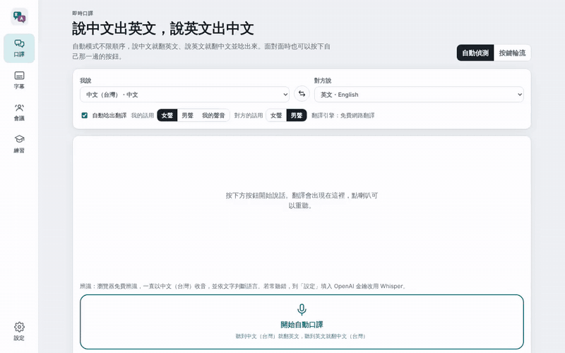

<p align="center">
  <a href="README.md">English</a> · <a href="README.zh-CN.md">简体中文</a> · <a href="README.zh-TW.md">繁體中文</a> · <a href="README.ja.md">日本語</a> · <a href="README.ko.md">한국어</a><br>
  <a href="README.de.md">Deutsch</a> · <strong>Español</strong> · <a href="README.fr.md">Français</a> · <a href="README.pt-BR.md">Português (Brasil)</a> · <a href="README.vi.md">Tiếng Việt</a> · <a href="README.id.md">Bahasa Indonesia</a> · <a href="README.it.md">Italiano</a>
</p>

<p align="center"></p>
<h1 align="center">Intérprete en vivo, subtítulos traducidos, actas de reuniones y práctica de idiomas</h1>
<p align="center">TalkBridge 語橋 · Aplicación web instalable (PWA) para Chrome, Edge, Android y iPhone</p>
<p align="center">
  
  
  <a href="LICENSE"></a>
</p>

```text
Abrir en Chrome o Edge: https://tonykfr1234.github.io/TalkBridge/
```

---

TalkBridge convierte tu teléfono o portátil en un intérprete de bolsillo: hablas en chino y lo dice en inglés; la otra persona responde en inglés y lo dice en chino. Junto a un altavoz del ordenador, subtitula vídeos y reuniones en línea en tu idioma. En reuniones graba el audio, transcribe en directo con etiquetas de hablante y traducción paralela, y genera actas, tareas y un resumen en inglés para exportar o enviar por LINE. El modo de práctica entrena frases de negocios y viajes en inglés, vietnamita y tailandés con puntuación de pronunciación y un compañero de rol con IA. Todo funciona en el navegador y los datos se quedan en el dispositivo; las funciones de de IA son opcionales y usan tu propia clave de DeepSeek (predeterminado), OpenAI o Claude. Los hablantes se separan automáticamente por la voz y cada tarea tiene responsable y fecha límite.

Los 12 idiomas del README traducen la documentación. La interfaz de la app está actualmente en chino tradicional.

## Inicio rápido

1. Abre la URL de arriba en Chrome/Edge (Windows, macOS, Android) o Safari (iPhone).
2. Permite el micrófono y elige ambos idiomas en la pestaña «口譯».
3. Pulsa «開始自動口譯» y habla; la traducción aparece y se lee en voz alta.
4. Opcional: añade tu clave de API de Anthropic en «設定» para actas con IA, traducción con IA y juego de rol.

## Funciones

- Intérprete bidireccional (detección automática del hablante o pulsar para hablar), 22 idiomas
- Modo subtítulos: texto grande, pantalla completa, exportación .srt
- Reuniones: grabación, transcripción, etiquetas de hablante (teclas 1–9), traducción paralela, actas y tareas con IA, exportación .txt/.md/.srt/.json/audio, compartir por LINE
- Práctica: 8 escenarios × 6 frases (inglés, vietnamita, tailandés), puntuación de pronunciación, racha diaria, rol con IA, guías de estudio

<p align="center"></p>

<p align="center"><a href="docs/media/talkbridge-demo.mp4">MP4</a></p>

Documentación completa en el <a href="README.md">README en inglés</a>.

## Licencia

MIT © 2026 Tony Hsu and contributors.

Build by Tony · 2026 年製作 · ☕ [Buy Tony a coffee](https://tonykfr1234.github.io/TalkBridge/donate.html)
