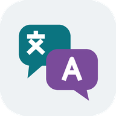
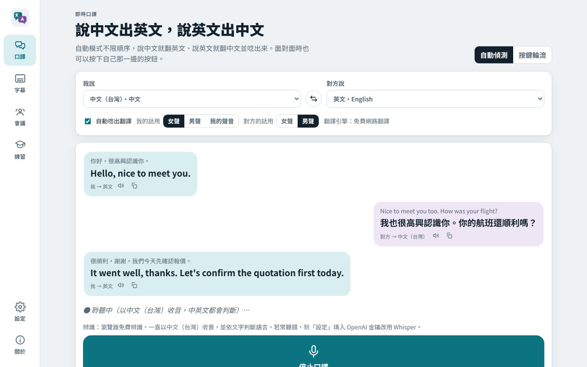
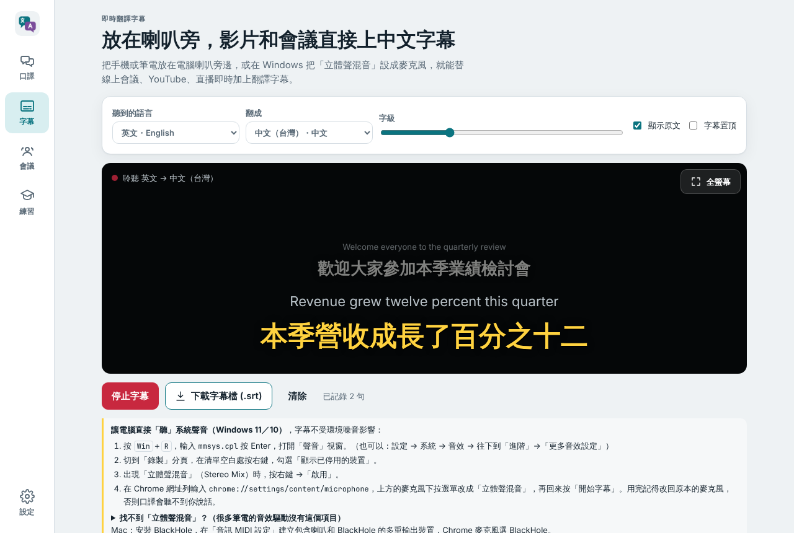
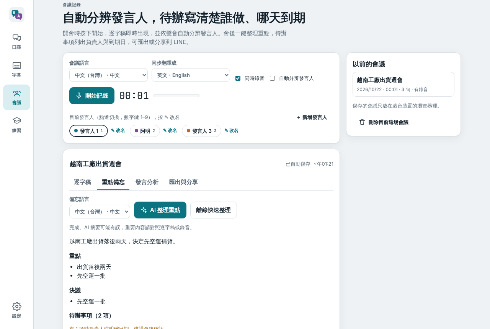
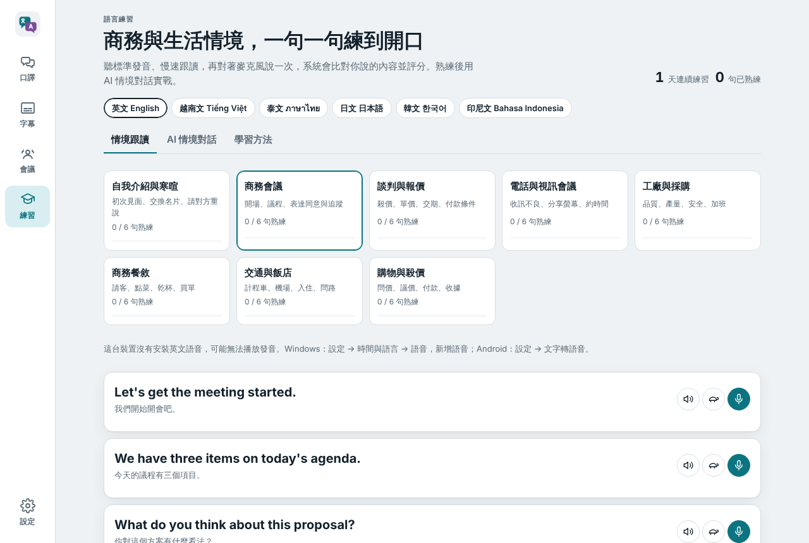
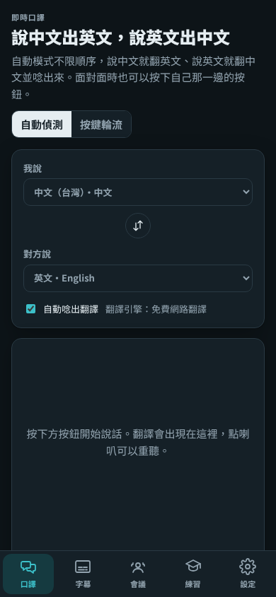

<p align="center">
  <a href="README.md">English</a> · <a href="README.zh-CN.md">简体中文</a> · <strong>繁體中文</strong> · <a href="README.ja.md">日本語</a> · <a href="README.ko.md">한국어</a><br>
  <a href="README.de.md">Deutsch</a> · <a href="README.es.md">Español</a> · <a href="README.fr.md">Français</a> · <a href="README.pt-BR.md">Português (Brasil)</a> · <a href="README.vi.md">Tiếng Việt</a> · <a href="README.id.md">Bahasa Indonesia</a> · <a href="README.it.md">Italiano</a>
</p>

<p align="center"></p>
<h1 align="center">即時口譯、翻譯字幕、會議記錄與語言練習</h1>
<p align="center">TalkBridge 語橋 · 可安裝的網頁 App（PWA），支援 Chrome、Edge、Android 與 iPhone</p>
<p align="center">
  
  
  <a href="LICENSE"></a>
</p>
<p align="center">
  <a href="#quick-start">快速開始</a> · <a href="#features">功能</a> · <a href="#screenshots">畫面</a> · <a href="#how-it-works">運作原理</a> · <a href="#faq">常見問題</a> · <a href="#documentation">文件</a>
</p>

```text
用 Chrome 或 Edge 開啟 https://tonykfr1234.github.io/TalkBridge/ → 允許麥克風 → 直接開口說
```

---

TalkBridge 把手機或筆電變成隨身口譯員：你說中文，它用英文說出來；對方用英文回答，它再翻成中文唸給你聽。放在電腦喇叭旁邊，就能替影片和線上會議即時加上中文字幕。開會時可以同時錄音、即時逐字稿、標記發言人、同步中翻英，會後一鍵整理重點、待辦事項與英文摘要，匯出或直接分享到 LINE。練習模式提供英文、越南文、泰文的商務與出差情境句，會對你的發音評分，還能和 AI 進行情境對話並即時修正。

所有功能都在瀏覽器裡執行，會議與練習紀錄只存在你的裝置。Claude AI 功能為選用，使用你自己的 Anthropic API 金鑰。

12 種 README 語言是文件翻譯，App 介面目前使用繁體中文。

<a id="quick-start"></a>
## 快速開始

1. 電腦或 Android 用 **Chrome / Edge**，iPhone 用 **Safari**，開啟上方網址。
2. 允許麥克風，在「口譯」分頁選好「我說」和「對方說」的語言。
3. 按「開始自動口譯」直接說話，翻譯會以對話泡泡顯示並唸出來。
4. 選用：在「設定 → 安裝到主畫面」或瀏覽器選單「安裝應用程式」，之後就能像一般 App 全螢幕開啟。
5. 選用：在「設定」貼上 Anthropic API 金鑰，啟用 AI 會議重點、發言人建議、AI 翻譯和 AI 情境對話。

**自己架設：**下載後用 HTTPS 或 `localhost` 開啟（瀏覽器規定麥克風只能在安全連線使用）：

```bash
git clone https://github.com/tonykfr1234/TalkBridge.git
cd TalkBridge
python3 -m http.server 8080      # 開啟 http://localhost:8080
```

專案內建 GitHub Actions，每次推送到 `main` 都會自動部署到 GitHub Pages。

<a id="features"></a>
## 功能

| 功能 | 說明 |
| --- | --- |
| 雙向口譯 | **自動偵測**模式先看文字系統（中文字、拉丁字母、泰文…），再參考翻譯服務偵測到的語言，判斷是誰在說話，翻成另一種語言並唸出來，接著改聽對方的語言。**按鍵輪流**模式兩人各一個按鈕。也可以直接打字。 |
| 22 種語言 | 中文（台灣／簡體／粵語）、英文、越南文、泰文、日文、韓文、印尼文、馬來文、菲律賓文、高棉文、緬甸文、印地文、西班牙文、法文、德文、義大利文、葡萄牙文、俄文、阿拉伯文、土耳其文 |
| 字幕模式 | 電視字幕風格的大字翻譯，上方小字顯示原文。說話中的字每 0.7 秒翻譯一次，字幕跟得上講者。可全螢幕、調整字級、置頂，匯出 `.srt` |
| 會議記錄 | 即時逐字稿與時間碼、同步翻譯（例如中翻英）、錄音與音量表、暫停／繼續、自動存在裝置 |
| 發言人標記 | 點選發言人或按數字鍵 **1–9** 切換目前說話的人，點兩下改名，事後可逐句修正。AI 可依談話內容建議發言人 |
| 重點與分析 | AI 會議記錄：摘要、重點、決議、待辦事項（事項／負責人／期限）、待確認問題、每位發言人的角色，以及英文摘要。沒有金鑰也能用離線整理挑出關鍵句、可能的待辦和問題。每位發言人的發言比例長條圖 |
| 匯出與分享 | `.txt` 逐字稿、`.md` 會議記錄、`.srt` 字幕、`.json`、原始錄音檔。手機按「分享檔案」會開啟系統分享選單，可直接傳到 LINE；「用 LINE 傳送重點」傳送摘要文字 |
| 語言練習 | 8 個情境 × 6 句（商務會議、談判報價、電話視訊、工廠採購、商務餐敘、交通飯店、購物殺價、自我介紹），英文、越南文、泰文由人工撰寫，泰文附拼音與男／女口吻切換；日文、韓文、印尼文即時產生 |
| 發音評分 | 播放、慢速播放，再對著麥克風說一次：系統把聽到的內容與目標句對齊，給 0–100 分並標出漏掉的字。85 分以上記為熟練，並累計連續練習天數 |
| AI 情境對話 | Claude 扮演情境中的對方，用目標語言回覆並附中文翻譯與拼音，同時修正你上一句的用字和語氣 |
| 學習方法 | 各語言的聲調與實用技巧：越南文六個聲調與稱謂、泰文聲調與句尾禮貌語、英文連音、日韓敬語 |

單一麥克風無法從聲紋分辨不同的人，所以發言人以你的標記為準；AI 建議是根據談話內容判斷，不是聲紋。

<a id="screenshots"></a>
## 畫面

| 口譯 | 字幕 |
| --- | --- |
|  |  |
| **會議記錄** | **語言練習** |
|  |  |

<p align="center"></p>

畫面由自動化瀏覽器測試產生，語音為模擬輸入、翻譯為範例內容（`npm run shots`）。

<a id="how-it-works"></a>
## 運作原理

```text
麥克風 ─► 瀏覽器 Web Speech API ─► 文字 ─► 翻譯 ─► 對話泡泡／字幕／逐字稿
                                          │              │
                     Google（免費）→ MyMemory → Claude    └─► 語音朗讀
會議錄音 ─► MediaRecorder ─► IndexedDB（本機）─► 匯出／系統分享／LINE
逐字稿 ─► Claude（你的金鑰，結構化 JSON）─► 會議重點、待辦、發言人建議
```

- **語音辨識**使用瀏覽器內建服務。Chrome 會把語音送到 Google 辨識，需要網路；瀏覽器自動中斷後會自動重新開始。
- **翻譯**先用免費 Google 翻譯，失敗改用 MyMemory，有金鑰時再改用 Claude。商務用語想更自然，可在設定選「Claude AI 翻譯」。
- **Claude** 透過官方 Anthropic TypeScript SDK（打包於 `js/vendor/`）呼叫，會議記錄與家教使用結構化輸出、adaptive thinking 與伺服器端拒答備援。預設模型 Claude Opus 5.5，可改選 Sonnet 5.5 或 Haiku 5.5。
- **資料**：設定與練習進度存在 `localStorage`，會議與錄音存在 IndexedDB。除了送去翻譯的文字，以及你啟用時送給 Claude 的內容，不會上傳任何資料。

<a id="faq"></a>
## 常見問題

**哪些瀏覽器可以用？** Windows、macOS、Android 上的 Chrome 和 Edge 辨識效果最好；iPhone／iPad 請用 Safari 並開啟「聽寫」。Firefox 沒有語音辨識，但可打字翻譯和播放練習句。

**不用第二台裝置，怎麼替電腦聲音上字幕？** Windows 11／10：按 Win＋R 輸入 `mmsys.cpl` →「錄製」分頁 → 空白處按右鍵「顯示已停用的裝置」→ 啟用「立體聲混音」，再到 `chrome://settings/content/microphone` 把麥克風選成它。沒有「立體聲混音」的電腦改用免費的 VB-Audio Virtual Cable；macOS 用 BlackHole。詳細步驟見[使用說明](docs/USER_GUIDE.zh-TW.md)。

**為什麼某些語言唸不出來？** 裝置沒有安裝該語言的語音。Windows：設定 → 時間與語言 → 語音；Android：設定 → 文字轉語音。

**自動模式一定判斷得對嗎？** 先看文字系統，再看翻譯服務偵測的語言，並預期雙方輪流說話。兩種語言用同一套字母（例如英文和西班牙文）時只能靠偵測，建議改用「按鍵輪流」。

**API 金鑰安全嗎？** 金鑰只存在這個瀏覽器，只會送到 `api.anthropic.com`。建議設定用量上限，在共用電腦上用完請清除。

<a id="documentation"></a>
## 文件

- [使用說明](docs/USER_GUIDE.zh-TW.md)
- [架構說明（英文）](docs/ARCHITECTURE.md)
- [更新紀錄](CHANGELOG.md) · [參與貢獻](CONTRIBUTING.md) · [安全政策](SECURITY.md)

## 開發

```bash
npm install             # 只有瀏覽器測試需要 Playwright
npm test                # 單元測試（node:test）
npm run test:e2e        # 無頭 Chromium，模擬語音、翻譯與 Claude
npm run shots           # 同上，並更新 docs/media 截圖
python3 scripts/security_scan.py .
python3 scripts/generate_icon.py
scripts/build_vendor.sh # 重新打包 Anthropic SDK
```

不需要建置流程，App 是純 ES modules。

## 安全

請勿提交任何 API 金鑰，詳見 [SECURITY.md](SECURITY.md)。

## 授權

MIT © 2026 Tony Hsu and contributors。內附的 Anthropic SDK 為 Anthropic, PBC 的 MIT 授權（`js/vendor/anthropic-sdk.LICENSE.txt`）。
